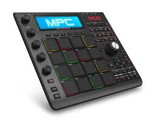
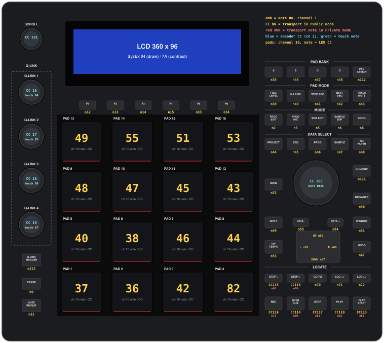
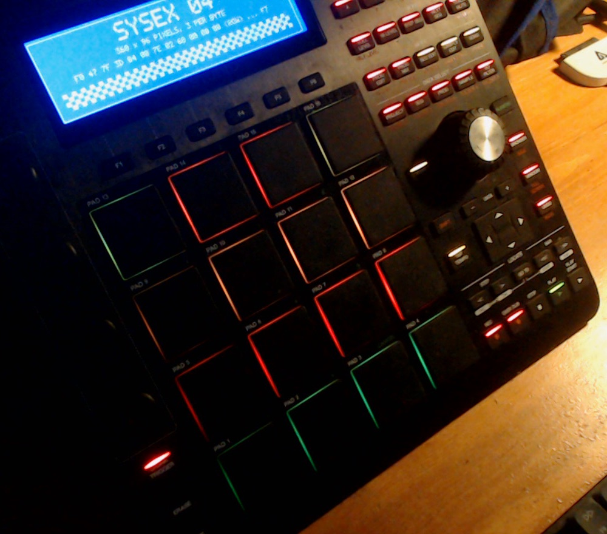
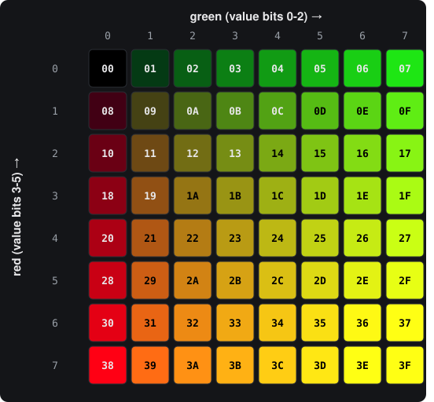
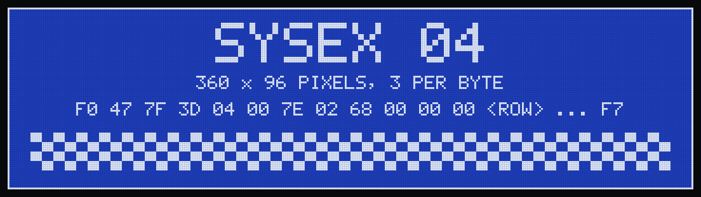
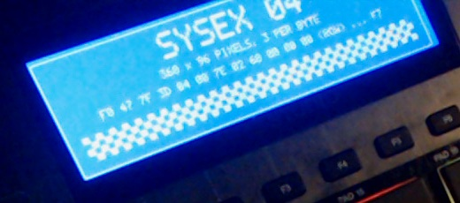
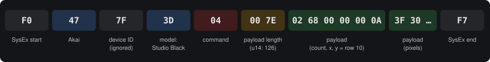
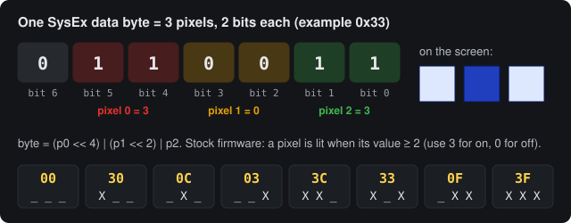
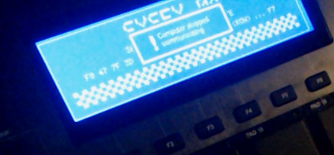

# Akai MPC Studio Black: MIDI and SysEx protocol

A complete, tested description of how the **Akai MPC Studio Black** talks over USB-MIDI. It covers every message the controller sends, every message it accepts, and the full SysEx command set, including the screen, LEDs, port modes, the host session and the firmware-update bootloader. With it you can drive the controller from any language or DAW script, without Akai's software.

> Not affiliated with or endorsed by Akai Professional / inMusic. Everything here was worked out by testing a retail unit (firmware 1.16) and by studying how its firmware handles messages. "MPC" and "Akai" are trademarks of their owners.

**How sure is each fact?** Every section is marked:

| Mark | Meaning |
|---|---|
| ✅ | **Confirmed** on an MPC Studio Black (firmware 1.16) by sending and capturing real messages, often checked with a webcam |
| 🔍 | **Static**: read from the firmware's message handling and consistent with everything confirmed, but not yet exercised on the device |

**Notation.** Bytes are hex. "Channel 1" means MIDI status low nibble `0` (`B0`); "channel 10" means low nibble `9` (`B9`). In code, those are channels 0 and 9.

---

## Contents

1. [Quick start](#1-quick-start)
2. [The controller at a glance](#2-the-controller-at-a-glance)
3. [USB device and MIDI ports](#3-usb-device-and-midi-ports)
4. [Port modes: Public and Private (SysEx 62)](#4-port-modes-public-and-private-sysex-62)
5. [What the controller sends](#5-what-the-controller-sends)
6. [LEDs](#6-leds)
7. [The screen (SysEx 04)](#7-the-screen-sysex-04)
8. [SysEx framing](#8-sysex-framing)
9. [SysEx command reference](#9-sysex-command-reference)
10. [Firmware update: the bootloader protocol](#10-firmware-update-the-bootloader-protocol)
11. [Device states a host should know about](#11-device-states-a-host-should-know-about)
12. [Recommended host start-up](#12-recommended-host-start-up)
13. [Complete example](#13-complete-example)
14. [Demo applications in this repository](#14-demo-applications-in-this-repository)
15. [Corrections to earlier versions of this page](#15-corrections-to-earlier-versions-of-this-page)
- [Appendix A: control matrix indices](#appendix-a-control-matrix-indices)
- [Appendix B: timing](#appendix-b-timing)
- [Appendix C: differences from the original MPC Studio](#appendix-c-differences-from-the-original-mpc-studio)

---

## 1. Quick start

The controller is class-compliant: plug it in, and it shows up as three MIDI ports on macOS, Windows and Linux. With Python and [mido](https://mido.readthedocs.io/):

```python
import mido

def port(names, suffix):
    return next(n for n in names if "MPC Studio Black" in n and n.endswith(suffix))

out = mido.open_output(port(mido.get_output_names(), "MPC Public"))
inp = mido.open_input(port(mido.get_input_names(), "MPC Public"))

out.send(mido.Message("control_change", channel=0, control=82, value=1))   # PLAY LED green
out.send(mido.Message("control_change", channel=9, control=37, value=0x3F)) # pad 1 amber

for msg in inp:          # play the controller
    print(msg)           # e.g. note_on channel=9 note=37 velocity=96 (pad 1)
```

Everything after this is detail: which numbers each control uses, how the two port modes differ, and the SysEx commands for the screen and the rest.

---

## 2. The controller at a glance



*Every control and the MIDI it uses (drawn to scale). `nNN` = Note On on channel 1, 127 on press and 0 on release. Transport buttons send a **CC** in Public mode and a **note** (in red) in Private mode. Q-Links and the dials send CCs; touching a Q-Link sends a note. Pads use channel 10.*



*A real unit on stock firmware: the screen drawn with SysEx `04`, the pads lit with 16 different colour values, and the button LEDs in colour 1 and colour 2, all sent from a script. Photo from a webcam.*

| Part | Count | Talks with |
|---|---|---|
| Velocity- and pressure-sensitive pads (red/green LEDs) | 16 | Note On/Off + poly aftertouch on channel 10; LED colour by CC on channel 10 |
| Buttons | 52 | Note On on channel 1; 29 have LEDs (CC on channel 1) |
| Q-Link knobs, touch-sensitive | 4 | CC 16–19 + touch notes 84–87 |
| SCROLL knob | 1 | CC 101 |
| Data dial (endless) | 1 | CC 100, relative |
| Monochrome LCD, 360 × 96 | 1 | SysEx `04` |
| DIN MIDI in/out | 1 pair | the third USB port, "MPC Port 1" |

---

## 3. USB device and MIDI ports

### Device ✅

| Field | Value |
|---|---|
| Vendor / product ID | `0x09E8` / `0x003D` |
| bcdDevice | `0x0116` (firmware 1.16) |
| Strings | `Akai` / `MPC Studio Black` / serial `NO SERIAL NUMBER` |
| Class | standard USB Audio class (Audio Control + MIDI Streaming). **No driver needed** |
| Speed / power | USB 1.1 full speed, bus powered, 500 mA |
| Endpoints | `0x01` bulk OUT (host → device), `0x82` bulk IN (device → host), 64 bytes |

Akai's optional driver packages aren't needed. On Windows their driver replaces the standard one for the MIDI interface; on macOS a small kernel extension only re-labels the MIDI interface so Akai's own MIDI plug-in takes it over. The messages are the same either way.

### Ports (USB-MIDI cables)

| Cable | Port name | Host → device | Device → host |
|---|---|---|---|
| 0 | **MPC Private** | controls and LEDs when Private mode is on | controls in Private format; **every Akai SysEx reply** ✅ |
| 1 | **MPC Public** | controls and LEDs when Public mode is on (the power-up default) | controls in Public format; SysEx `54` echoes ✅ |
| 2 | **MPC Port 1** | forwarded to the **DIN MIDI OUT** jack, all message types including SysEx 🔍 | everything arriving on the **DIN MIDI IN** jack, including clock, MTC and SysEx 🔍 |

On macOS the ports appear as "MPC Studio Black MPC Private", "MPC Studio Black MPC Public" and "MPC Studio Black MPC Port 1".

- **SysEx is accepted on cable 0 or 1, in any mode.** ✅
- On cables 0 and 1 the device only reacts to Note On, Note Off, Control Change and Pitch Bend. Poly aftertouch, program change and channel pressure are ignored. 🔍
- If USB isn't configured (power only), SysEx replies go out of the DIN MIDI OUT jack instead. 🔍

---

## 4. Port modes: Public and Private (SysEx 62)

The controller has **one mode byte** that decides which of its two control ports is active and in which format controls are reported. Set it with:

```
F0 47 7F 3D 62 00 01 <mode> F7
```

| Bit | Mask | Meaning |
|---|---|---|
| 0 | `01` | **Private** port active |
| 1 | `02` | **Public** port active |
| 5 | `20` | Public: mute the transport CCs of STOP, PLAY, PLAY START, STEP <, STEP > |
| 6 | `40` | Public: mute the transport CCs of REC and OVER DUB |
| 2–4 | | stored and read back, otherwise unused |

| Value | Result |
|---|---|
| `00` | power-up value; behaves exactly like `02` |
| **`02`** | **Public only**: what a plain MIDI host sees |
| **`61`** | **Private only** + both mutes: what the MPC software uses |
| `03` | both ports at once, each in its own format |

```text
F0 47 7F 3D 62 00 01 61 F7     → Private (MPC software style)
F0 47 7F 3D 62 00 01 02 F7     → back to Public
```

**Side effects** ✅:
- A value with **bit 0 set** clears every LED, blanks the screen and resets the Q-Link values to 0.
- A value with **bit 1 set** (and bit 0 clear) draws the MPC splash and ends the host session (§9.7).
- A value with neither bit only updates bits 5–6.
- Redraw the screen and LEDs after switching.
- The mode is **not saved**: it is back to `00` at every power-up.
- **LED messages are only accepted on an active port.** In mode `61`, LEDs sent to MPC Public are ignored.
- Read the current mode back from the Identity reply (§9.1, bytes 14–17).

### What changes between the two ports ✅

| | Public (bit 1) | Private (bit 0) |
|---|---|---|
| Normal buttons | Note On, channel 1 | Note On, channel 1 (same numbers) |
| Transport buttons | **CC 113–119** on channel 1 | **notes 68–83** on channel 1 |
| Q-Links (CC 16–19), SCROLL (CC 101) | **absolute** 0–127 | **relative**, accelerated |
| Data dial (CC 100) | relative | relative |
| Q-Link touch (notes 84–87) | Note On 127 / 0 | Note On 127 / 0 |
| Pads | channel 10 notes + poly aftertouch | the same |
| LED messages accepted | on MPC Public only | on MPC Private only |

**Which to use?** A plain DAW mapping: stay in Public. A host script or bridge: Private (`61`) or both (`03`), which gives relative knobs, a unique note per control, and the same number for a button and its LED.

---

## 5. What the controller sends

### 5.1 Pads ✅

Channel 10:
- **Note On** `99 nn vv` with velocity 1–127
- **Note Off** `89 nn 00`
- **Poly aftertouch** `A9 nn pp` while held, sent only when the pressure changes

| | column 1 | column 2 | column 3 | column 4 |
|---|---|---|---|---|
| **top row** | PAD 13: **49** | PAD 14: **55** | PAD 15: **51** | PAD 16: **53** |
| | PAD 9: **48** | PAD 10: **47** | PAD 11: **45** | PAD 12: **43** |
| | PAD 5: **40** | PAD 6: **38** | PAD 7: **46** | PAD 8: **44** |
| **bottom row** | PAD 1: **37** | PAD 2: **36** | PAD 3: **42** | PAD 4: **82** |

- The note numbers follow the General MIDI drum map loosely; they are **fixed in the firmware**. PAD BANK A–D don't change them; the host decides what banks mean.
- Timing 🔍: the Note On goes out **5 ms** after the pad crosses its threshold, using the peak in that window as the velocity. Aftertouch starts **15 ms** after the threshold and updates every 20 ms.
- Sensitivity (thresholds and the velocity curve) comes from the settings record, SysEx `5A` (§9.5).

### 5.2 Buttons ✅

Channel 1, **Note On** with velocity `7F` on press and `00` on release. The device never sends Note Off (`8x`) for buttons.

| Note | Button | Note | Button | Note | Button |
|---|---|---|---|---|---|
| 2 | PROG EDIT | 39 | FULL LEVEL | 54 | DATA + |
| 3 | PROG MIX | 40 | 16 LEVEL | 55 | DATA − |
| 5 | SEQ EDIT | 41 | STEP SEQ | 56 | CURSOR UP |
| 6 | SAMPLE EDIT | 42 | NEXT SEQ | 57 | CURSOR DOWN |
| 8 | SONG | 43 | TRACK MUTE | 65 | CURSOR LEFT |
| 9 | ERASE | 44 | PROJECT | 66 | CURSOR RIGHT |
| 11 | NOTE REPEAT | 45 | SEQ | 67 | UNDO |
| 12 | F1 | 46 | PROG | 70 | GO TO |
| 13 | F2 | 47 | SAMPLE | 71 | LOCATE << (BAR <<) |
| 14 | F3 | 48 | NO FILTER | 72 | LOCATE >> (BAR >>) |
| 15 | F4 | 49 | SHIFT | 111 | NUMERIC |
| 33 | F5 | 50 | BROWSER | 112 | PAD ASSIGN |
| 34 | F6 | 51 | WINDOW | 113 | QLINK TRIGGER |
| 35–38 | PAD BANK A–D | 52 | MAIN | | |
| | | 53 | TAP TEMPO | | |

**Transport buttons depend on the port:**

| Button | Public: CC on channel 1 (`7F` / `00`) | Private: Note On on channel 1 |
|---|---|---|
| PLAY START | CC 113 | note 83 |
| OVER DUB | CC 114 | note 80 |
| STEP < | CC 115 | note 68 |
| STEP > | CC 116 | note 69 |
| STOP | CC 117 | note 81 |
| PLAY | CC 118 | note 82 |
| REC | CC 119 | note 73 |

- Mode bits `20` and `40` mute these Public CCs (§4).
- In Private mode, **every button's note number is also its LED number** (§6.1), transport included.
- CC 113 is both the PLAY START *input* (Public) and the QLINK TRIGGER *LED*. They travel in opposite directions, so they don't clash.

> **SHIFT + data dial** doesn't send CC 100: the device uses it to change the LCD contrast and **saves the new value to flash** (§9.10). A host can't turn this off. If the screen ever looks blank, someone probably turned it while holding SHIFT.

### 5.3 Q-Links, SCROLL and the data dial ✅

| Control | Touch: Note On ch 1 (`7F` / `00`) | Turn: CC on ch 1 | Public | Private |
|---|---|---|---|---|
| Q-Link 1 (top) | note 84 | CC 16 | absolute 0–127 | relative |
| Q-Link 2 | note 85 | CC 17 | absolute | relative |
| Q-Link 3 | note 86 | CC 18 | absolute | relative |
| Q-Link 4 (bottom) | note 87 | CC 19 | absolute | relative |
| SCROLL (top left) | — | CC 101 | absolute | relative |
| Data dial | — | CC 100 | relative | relative |

- **Absolute:** the device adds up the movement and clamps it to 0–127. Every value starts at 0 at power-up and whenever Private mode is entered. **The host can't preset these values**, so soft takeover is up to the host.
- **Relative:** a 7-bit two's-complement step, `01`…`3F` = +1…+63 and `7F`…`40` = −1…−64. It is accelerated: slow turns send ±1, fast turns larger steps (±5 seen).

```python
def relative(value):          # CC value → signed step
    return value - 128 if value >= 64 else value
```

- The data dial always sends `01` (clockwise) or `7F` (counter-clockwise) for slow turns.
- The encoders are read every 1 ms 🔍.
- There is **no per-knob setting**: the port mode is the only switch, and it applies to all six encoders.

### 5.4 Other output
- **DIN MIDI IN** → host on **MPC Port 1**, unchanged 🔍.
- **SysEx replies** (§9) go to **MPC Private**. The Identity reply goes to both Private and Public ✅.

---

## 6. LEDs

LED state persists until changed, and the controller never lights its own LEDs while a host is connected. Send LED messages to the **active** port (MPC Public at power-up).

### 6.1 Button LEDs ✅

**Control Change on channel 1: `B0 <led> <state>`**, where state `00` = off, `01` = colour 1, `02`–`7F` = colour 2. There are no brightness levels.

| LED (CC) | Button | Colour 1 | Colour 2 |
|---|---|---|---|
| 2, 3, 5, 6, 8 | PROG EDIT, PROG MIX, SEQ EDIT, SAMPLE EDIT, SONG | red | amber |
| 35–38 | PAD BANK A–D | red | amber |
| 52 | MAIN | red | amber |
| 39–43 | FULL LEVEL, 16 LEVEL, STEP SEQ, NEXT SEQ, TRACK MUTE | red | red |
| 44–48 | PROJECT, SEQ, PROG, SAMPLE, NO FILTER | red | red |
| 50, 51, 67 | BROWSER, WINDOW, UNDO | red | red |
| 112, 113 | PAD ASSIGN, QLINK TRIGGER | red | red |
| 53 | TAP TEMPO | amber | amber |
| **73** | REC | red | red |
| **80** | OVER DUB | red | red |
| **82** | PLAY | green | green |

No LED: F1–F6, SHIFT, DATA ±, the cursor buttons, NUMERIC, STEP < / >, GO TO, LOCATE << / >>, STOP, PLAY START and ERASE. NOTE REPEAT is untested.

```text
B0 34 02     MAIN amber       (LED 52 = 0x34; send on the active port)
B0 34 01     MAIN red
B0 34 00     MAIN off
B0 52 01     PLAY green       (LED 82 = 0x52)
```

The tables in this page use decimal numbers; the raw bytes are hex.

### 6.2 Pad LEDs ✅

**Control Change on channel 10: `B9 <pad note> <colour>`**, with

> **colour = (red << 3) | green**, red and green 0–7 each

The pads light up as a glow around each pad. There are **64 colours from red through amber to green**, and no blue. Bit 6 is ignored (64 = off, 127 is the same as 63).



*Rendered chart of all 64 values (the colours are an approximation of how the LEDs look). Red rises down, green rises right; equal amounts make amber.*

| Value | Look |
|---|---|
| `00` | off |
| `01`–`07` | green, dim → bright |
| `08`, `10`, `20`, `38` | red, dim → bright |
| `09`, `12`, `24`, `3F` | amber, dim → bright |

```python
def pad_colour(red, green):            # 0-7 each
    return (red << 3) | green

out.send(mido.Message("control_change", channel=9, control=37, value=pad_colour(7, 0)))  # pad 1 red
out.send(mido.Message("control_change", channel=9, control=53, value=pad_colour(0, 7)))  # pad 16 green
```

### 6.3 All LEDs in one message: SysEx 03 ✅
See §9.2. It writes the whole LED register image at once.

### 6.4 Q-Link ring LEDs 🔍
The firmware still has a handler for Q-Link LED rings (ring value on channel 1 CC 16–31, ring style on channel 2 CC 16–31) from the original MPC Studio. **The Black has no rings**: these messages do nothing visible.

---

## 7. The screen (SysEx 04)

The screen is a **360 × 96 monochrome LCD** with a blue backlight; lit pixels are pale. The host draws on it with SysEx `04`, one horizontal run of pixels per message.



*A frame drawn with SysEx `04` (render of the exact pixels). Below: the same frame on a real unit, photographed with a webcam.*



### 7.1 The message ✅

```
F0 47 7F 3D 04 <len u14> <count u14> <x u14> <y u14> <pixel bytes …> F7
                len = 6 + count/3
```

| Field | Meaning |
|---|---|
| `len` | payload length (u14 = two 7-bit bytes, high first) |
| `count` | number of pixels in this run. Use a multiple of 3 |
| `x` | first pixel's column, 0–359. Use a multiple of 3 |
| `y` | row, 0–95 |
| pixel bytes | `count/3` bytes, three pixels each |

The run must fit: `x + count ≤ 360` and `y < 96`.



**A full row** (360 pixels at x = 0) always starts the same way:

```text
F0 47 7F 3D 04 00 7E 02 68 00 00 00 <row> <120 pixel bytes> F7
               ^len=126 ^count=360 ^x=0  ^y
```

### 7.2 Pixel bytes ✅



Each byte carries **three pixels, 2 bits each**: `byte = (p0 << 4) | (p1 << 2) | p2`. Bit 6 stays 0, so every byte is valid SysEx data.

The stock firmware drives the LCD in monochrome: **a pixel is lit when its value is 2 or 3**. Use `3` for on and `0` for off, which gives `0x30`, `0x0C` and `0x03` for one lit pixel and `0x3F` for all three. (The LCD controller can do four grey levels, and the 2-bit format carries them, but the stock firmware doesn't enable that mode.)

### 7.3 Drawing a frame

```python
def row_message(pixels, y):
    """pixels: 360 booleans for row y → one SysEx 04 message (mido data, no F0/F7)."""
    data = []
    for i in range(0, 360, 3):
        p0, p1, p2 = (3 if pixels[i + k] else 0 for k in range(3))
        data.append(p0 << 4 | p1 << 2 | p2)
    payload = [0x02, 0x68, 0x00, 0x00, 0x00, y] + data   # count=360, x=0, y
    n = len(payload)                                     # 126
    return mido.Message("sysex", data=[0x47, 0x7F, 0x3D, 0x04, n >> 7, n & 0x7F] + payload)

for y in range(96):
    out.send(row_message(frame[y], y))                   # frame: 96 rows of 360 booleans
```

**Partial updates** are just shorter runs. For example, 12 lit pixels at x = 6, y = 10:

```text
F0 47 7F 3D 04 00 0A  00 0C  00 06  00 0A  3F 3F 3F 3F  F7
               len=10 count=12 x=6  y=10   12 pixels
```

### 7.4 Behaviour and speed ✅

- The device keeps its own framebuffer and only sends changed bytes to the LCD, so **resending unchanged rows is cheap**.
- **Nothing times out**: the image stays until it is overwritten, except for mode changes (§4) and the session-timeout box (§9.7).
- Measured throughput on a stock unit (macOS, frames of changing checkerboards):

| Test | Result |
|---|---|
| One full frame (96 row messages, 12,864 bytes) | 88 ms |
| Full frames, one message per row | **about 12 frames/s** (~150 KiB/s) |
| Rows split into 4 messages | about 15 frames/s |
| Only 8 rows changed per frame | about 128 frames/s |
| Identity round trip, idle | 0.75 ms |

The limit is the device processing bytes, not the number of messages: nothing was dropped or torn at full rate. In practice, redraw only what changed.

---

## 8. SysEx framing

### 8.1 Host → device ✅
```
F0 47 <device> 3D <cmd> <len_hi> <len_lo> <payload …> F7
```
- `47` = Akai. `3D` = the MPC Studio Black's model ID.
- `<device>` is **ignored**; `7F` is conventional.
- **Length** = payload byte count, `len_hi * 128 + len_lo`. It must match exactly.
- Every payload byte must be below `0x80`, or the whole message is dropped.
- The longest SysEx the device assembles is 1056 bytes 🔍. Unknown commands are silently ignored.
- Send on **MPC Public or MPC Private**, in any mode. Commands run in arrival order.

### 8.2 Device → host ✅
```
F0 47 00 3D <cmd> <len_hi> <len_lo> <payload …> F7
```
Always on **MPC Private** (cable 0), whatever port the request came in on and whatever the mode.

### 8.3 Value encodings
| Name | Encoding |
|---|---|
| **u14** | two bytes `hi lo` = `hi * 128 + lo` |
| **nibbles** | each byte carries 4 bits (`0x`); multi-byte values most significant nibble first |
| **u32 as 4 × 7** | four bytes, 7 bits each, most significant first (28 bits) |

---

## 9. SysEx command reference

| Cmd | Name | Reply | Survives power-off? | Status |
|---|---|---|---|---|
| Universal `7E … 06 01` | Identity Request | `7E … 06 02` | — | ✅ |
| `03` | Write LED image | — | no | ✅ |
| `04` | Draw pixels | — | no | ✅ |
| `08` | Inject a control event | MIDI | no | ✅ |
| `50` | Authentication challenge | `51` | no | ✅ |
| `52` | Ping / host session | `53` | no | ✅ |
| `54` | Echo raw MIDI to the host | MIDI on Public | no | ✅ |
| `5A` (empty) | Read settings | `5A` | no | ✅ |
| `5A` (32 bytes) | Write settings | — | **yes, flash** | 🔍 |
| `62` | Set port mode | — | no | ✅ |
| `72` | Enter the bootloader | — (device restarts) | **erases the firmware** | ✅ |
| `76` | Firmware checksum | `77` | no | ✅ |
| `78` | Write 4 user bytes | — | **yes, flash** | 🔍 |
| `79` | Write serial number | — | **yes, flash** | 🔍 |
| `7A` | Set LCD contrast | — | **yes, flash** | ✅ |

> ⚠️ **Commands that write flash** (`5A` write, `72`, `78`, `79`, `7A`) change things that survive power-off. A bad `7A` value makes the screen look dead; `72` erases the controller's firmware and waits for a new one (§10). Only send them on purpose.

### 9.1 Identity Request ✅

```text
→ F0 7E 7F 06 01 F7                        (device ID 7F or 00)
← F0 7E 00 06 02 47 3D 00 19 00 01 01 06 00 m3 m2 m1 m0 s0 … s15 F7
```

| Bytes | Value | Meaning |
|---|---|---|
| 5 | `47` | Akai |
| 6–7 | `3D 00` | family `0x003D` (MPC Studio Black) |
| 8–9 | `19 00` | member `0x0019` |
| 10–13 | `01 01 06 00` | firmware version 1.1.6.0 |
| 14–17 | `m3 m2 m1 m0` | the current **mode byte** as u32-4×7, e.g. `00 00 00 61` in Private mode |
| 18–33 | `s0 … s15` | the unit's serial number: 15 ASCII characters + `00` |

The reply is sent on **both** Private and Public. In the bootloader the same reply comes back with mode `00 00 00 00` and serial bytes `01 02 … 10` (§10).

### 9.2 `03`: write LED image ✅

```text
F0 47 7F 3D 03 <len> <n0 n1 n2 n3 …> F7          len ≤ 128
```
Nibble pairs, **low nibble first**: register `i` = `n[2i] | n[2i+1] << 4`. It overwrites up to 64 LED registers from register 0, then refreshes. The registers hold the button LED bits and the pad colour bytes. The register layout is internal to the firmware, so prefer the CC messages of §6 for single LEDs. All `F` nibbles light everything; all `0` clears everything.

### 9.3 `04`: draw pixels ✅
See [§7](#7-the-screen-sysex-04).

### 9.4 `08`: inject a control event ✅

```text
F0 47 7F 3D 08 00 02 <matrix index> <state> F7         state 01 = press, 00 = release
```
Produces exactly the MIDI a physical press would, on the active port(s), in the active format. Great for automated tests. The matrix indices are in [Appendix A](#appendix-a-control-matrix-indices). Pads and encoders can't be injected. Injecting SHIFT (`2C`) turns the data dial into the contrast control until SHIFT is released.

```text
F0 47 7F 3D 08 00 02 1F 01 F7      press PLAY  → Public: B0 76 7F (CC 118)
F0 47 7F 3D 08 00 02 1F 00 F7      release PLAY → Public: B0 76 00
```

### 9.5 `5A`: settings record (pad sensitivity)

**Read** ✅
```text
→ F0 47 7F 3D 5A 00 00 F7
← F0 47 00 3D 5A 00 20 <A: 4 nibbles> <B: 4> <C: 8> <D: 8> <E: 8> F7
```

| Field | Meaning 🔍 | Example (a Black) |
|---|---|---|
| A (u16) | pad **release** threshold (raw ADC) | `0x0029` (41) |
| B (u16) | pad **press** threshold (raw ADC) | `0x0043` (67) |
| C (u32) | velocity curve parameter | `0x00031C67` |
| D (u32) | velocity curve parameter | `0x0000D400` |
| E (u32) | velocity curve parameter | `0x00018000` |

**Write** 🔍 (**flash**): `F0 47 7F 3D 5A 00 20 <32 nibbles> F7`. The nibbles are four u32s, most significant nibble first, in the order `(A << 16) | B`, `C`, `D`, `E`. That is a different layout from the read reply, so repack before writing back. This changes the pad sensitivity permanently; save the current record before experimenting.

### 9.6 `50` → `51`: authentication ✅

```text
→ F0 47 7F 3D 50 00 10 <16 nibbles: challenge> F7
← F0 47 00 3D 51 00 20 <16 nibbles: response> <16 nibbles: the challenge again> F7
```
The 16 challenge nibbles form two 32-bit words. The response is those words encrypted with **XTEA** (32 rounds) under a fixed key built into the firmware. It lets Akai's software check that it's talking to genuine hardware. **Nothing on the controller depends on it**: every command in this document works without authenticating. (The key is deliberately not published here.)

### 9.7 `52` → `53`: ping / host session ✅

```text
→ F0 47 7F 3D 52 00 04 <i0 i1 i2 i3> F7            session id, 4 × 7-bit
← F0 47 00 3D 53 00 05 <i0 i1 i2 i3> <status> F7
```

| Status | Meaning |
|---|---|
| `02` | new session opened with this id |
| `01` | the same session, refreshed |
| `00` | refused: another session is active (the reply echoes the **active** id) |

Once a session is open, the controller expects pings. It checks once a second, and **about 11 s after the last ping** it closes the session and draws a **"Computer stopped communicating"** box over the screen. The mode doesn't change; redraw to clear the box.



*About 11 s after a single ping, the controller drew its "Computer stopped communicating" box over the SysEx `04` drawing.*

**Ping every 2–5 s** while your host is running, or never ping at all (no session, no box). A `62` value with bit 1 set (and bit 0 clear) also ends the session.

### 9.8 `54`: echo raw MIDI to the host ✅

```text
F0 47 7F 3D 54 00 06 <h l h l h l> F7       each byte = h << 4 | l
```
The 3-byte message comes back to the host **on MPC Public** as if the controller had sent it. For example `9 0 3 C 7 F` → `90 3C 7F`. Firmware 1.16 needs **exactly 3 bytes** and only emits Note Off, Note On, poly aftertouch or Control Change 🔍.

### 9.9 `62`: set port mode ✅
See [§4](#4-port-modes-public-and-private-sysex-62).

### 9.10 `7A`: LCD contrast ✅ (writes flash)

```text
F0 47 7F 3D 7A 00 01 <contrast> F7          units ship with 50 (0x32); SHIFT + dial covers 0–99
```
Applied at once and **saved to flash**; it's restored at every power-up. The value isn't range-checked, and **values far from 50 make the screen look blank**. To recover:

```text
F0 47 7F 3D 7A 00 01 32 F7
```

### 9.11 `76` → `77`: firmware checksum ✅

```text
→ F0 47 7F 3D 76 00 00 F7
← F0 47 00 3D 77 00 01 <xor> F7             firmware 1.16: 51
```
The XOR of the firmware image's bytes, masked to 7 bits. Useful for telling firmware builds apart.

### 9.12 `72`: enter the bootloader ✅ (erases the firmware)

```text
F0 47 7F 3D 72 00 00 F7
```
The controller marks itself for update and restarts into its bootloader, which **erases the application firmware immediately** and waits for a new one over SysEx. The controller does nothing else until it receives one. See [§10](#10-firmware-update-the-bootloader-protocol) for the whole procedure and for recovery.

### 9.13 `78`, `79`: settings writes 🔍 (writes flash)
- `78`: `F0 47 7F 3D 78 00 04 <4 bytes> F7` stores 4 bytes (default `7F 7F 7F 7F`). Nothing reads them back.
- `79`: `F0 47 7F 3D 79 00 10 <16 bytes> F7` stores the **serial number** reported in the Identity reply.

### 9.14 Other IDs
No other command IDs are handled. The firmware contains reply builders for `40`, `41` and `43` that are never used.

---

## 10. Firmware update: the bootloader protocol

The MPC Studio Black has a small **bootloader** in its first 32 KB that can rewrite the application firmware over USB-MIDI. It is what Akai's updater uses. Everything here was tested on a Black ✅: installing a firmware image, reinstalling the stock firmware from a backup, and recovering from a transfer that was cut off half way.

> ⚠️ **Read this first.**
> - Entering update mode **erases the controller's firmware at once**. The controller does nothing useful until a complete image has been sent.
> - Only send an image **built for the MPC Studio Black**. The firmware inside Akai's updater for the *original* MPC Studio is for different hardware.
> - The bootloader itself and the settings pages (serial number, pad calibration, contrast) are never erased or written by this procedure, so a failed update can always be retried over USB (§10.6).

### 10.1 Entering update mode

| How | Message | Notes |
|---|---|---|
| From the running firmware | `F0 47 7F 3D 72 00 00 F7` on MPC Private or Public | the controller restarts into update mode |
| By hand | hold **MAIN** while plugging in, keep holding, and send `F0 47 00 3D 72 00 00 F7` (device ID **`00`**) | the bootloader only waits while MAIN is held; releasing it without the message starts the firmware normally |
| After a failed update | — | the bootloader starts in update mode by itself, because the image has no valid signature |

In update mode the bootloader enumerates with the **same USB IDs and port names** as the firmware, so a host finds it the same way.

### 10.2 Waiting for the erase
On entering update mode, the bootloader erases the whole application area (104 flash pages) before it accepts data, which takes 2–4 s. It doesn't answer during the erase. Either wait about **4 s**, or poll with the Identity Request until it answers.

**Telling the bootloader from the firmware:** its Identity reply reports the same version (1.1.6.0), but with mode bytes `00 00 00 00` and the "serial" bytes `01 02 03 … 10`:

```text
F0 7E 00 06 02 47 3D 00 19 00 01 01 06 00 00 00 00 00 01 02 03 04 05 06 07 08 09 0A 0B 0C 0D 0E 0F 10 F7
```

### 10.3 Sending the image

```text
F0 47 00 3D 70 <Intel HEX text, ASCII> F7
```
- The header must be exactly `F0 47 00 3D` (device ID `00`). **There is no length field**: the HEX text follows the `70` directly.
- The image may be split over **several messages, each with its own header, but only between HEX records**. A split inside a record corrupts it. Our tested setting: **16 records per message, 20 ms between messages**.
- Records:

| Record | Use |
|---|---|
| `04` (extended linear address) | upper 16 address bits, e.g. `:020000040800F2` |
| `00` (data) | 16 or 32 bytes each; **even address and length**; uppercase hex; CRLF line ends |
| `01` (end of file) | `:00000001FF` ends the transfer |
| `02`, `05` | `02` is treated like `04`; `05` is ignored. Don't send `03` |

- **Address range:** `0x08008000`–`0x0803B80F`. Writes below `0x08008000` (the bootloader) are skipped. Keep data out of `0x0803C000` and above: that's the settings area, which isn't erased.
- **The signature goes last.** The bootloader only starts an image whose 12 bytes at `0x0803B800` read `ACV1 Richard` (the 4 bytes after it are free). Send that record **at the end**: if a transfer stops early, the signature is still blank and the bootloader stays in update mode on the next power-up.
- A variant command `71` carries the same HEX text encrypted. Plain `70` does exactly the same job.

### 10.4 What the bootloader shows 🔍
The bootloader has no screen output, but it shows its progress on the pad LEDs (read from its code; the overall green-on-success was seen on the device):

| Pads | Meaning |
|---|---|
| pad 1 green / red / amber | update requested / no valid firmware / MAIN held, waiting |
| pad 2 red → green | waiting for USB → connected |
| pad 3 amber → green | erasing → erase done |
| pad 4 amber → green, pad 5 amber | waiting for data → receiving |
| **all pads green** | success: about 4 s later the controller drops off USB and starts the new firmware |
| pads 13–16 red | error, halted; power-cycle (see §10.6) |

### 10.5 No acknowledgement
The bootloader **never replies** except to the Identity Request: there is no per-record status. After the end-of-file record, wait about 5 s, then reconnect and send an Identity Request. A reply with the firmware's real serial number means the new firmware is running.

### 10.6 Recovery
- **The transfer stopped part-way** (cable pulled, host crashed): unplug and replug the controller. The signature wasn't written, so the bootloader starts straight in update mode (pad 1 red), erases again, and waits. Send the image again, **without** any `72` first (§10.1, last row). Tested ✅.
- **Error pads (13–16 red):** power-cycle. If the signature had already been written, the (possibly damaged) firmware starts; otherwise the bootloader waits for an image again.
- **To go back to stock**, send a stock firmware image the same way. If you plan to experiment, keep a full backup of the controller first.

### 10.7 Example timings (tested)
| Step | Time |
|---|---|
| `72` → bootloader on USB | under 1 s |
| Erase wait | 4 s |
| Stock 1.16 image: 229 messages of 16 records, 20 ms apart | about 6 s |
| Success pause → firmware answering Identity | about 5 s |
| **Total** | **about 15–20 s** |

---

## 11. Device states a host should know about

| State | When | Effect |
|---|---|---|
| Public only | power-up | §4 |
| Session timeout | ~11 s after the last `52` | "Computer stopped communicating" box over the screen; mode unchanged. Redraw to clear |
| Mode switch | `62` with bit 0 / bit 1 | clears LEDs and screen / draws the splash (§4) |
| Idle animation 🔍 | USB not configured for 5 s (power only) | chase pattern on the pads and buttons |
| SHIFT + data dial | user action | contrast change, saved to flash |
| Update mode | `72`, or no valid firmware | §10 |

---

## 12. Recommended host start-up

```text
1. Open MPC Private (in + out) and MPC Public (in + out).
2. F0 7E 7F 06 01 F7                → check family 3D 00; read the mode and serial
3. F0 47 7F 3D 62 00 01 61 F7       → Private mode (or 03 for both ports)
4. F0 47 7F 3D 52 00 04 i0 i1 i2 i3 F7, then every ~2 s
5. Draw the screen (04 × 96 rows) and set LEDs (B0 / B9 CCs on MPC Private)
6. Read input from MPC Private:
     channel 1 notes   → buttons, transport, Q-Link touch
     channel 1 CC 16–19, 100, 101 → encoders (relative)
     channel 10 notes + poly aftertouch → pads
7. On exit: F0 47 7F 3D 62 00 01 02 F7  → back to Public
```

---

## 13. Complete example

A small but complete Python host: Private mode, a session, a drawn screen, LEDs that follow the pads, and knob values on the screen.

```python
import threading, time
import mido

def find(names, suffix):
    return next(n for n in names if "MPC Studio Black" in n and n.endswith(suffix))

priv_out = mido.open_output(find(mido.get_output_names(), "MPC Private"))
priv_in  = mido.open_input(find(mido.get_input_names(), "MPC Private"))

def sysex(cmd, payload=()):
    n = len(payload)
    priv_out.send(mido.Message("sysex", data=[0x47, 0x7F, 0x3D, cmd, n >> 7, n & 0x7F, *payload]))

# --- screen -------------------------------------------------------------
frame = [[False] * 360 for _ in range(96)]

def flush(rows=range(96)):
    for y in rows:
        data = []
        for x in range(0, 360, 3):
            p = [3 if frame[y][x + k] else 0 for k in range(3)]
            data.append(p[0] << 4 | p[1] << 2 | p[2])
        sysex(0x04, [0x02, 0x68, 0x00, 0x00, 0x00, y, *data])

def bar(index, value):                       # four horizontal bars, one per Q-Link
    y0 = 12 + index * 20
    for y in range(y0, y0 + 12):
        for x in range(20, 340):
            frame[y][x] = (x - 20) < value * 320 // 127 or y in (y0, y0 + 11)
    flush(range(y0, y0 + 12))

# --- start-up -------------------------------------------------------------
sysex(0x62, [0x61])                           # Private mode (also clears LEDs + screen)
sysex(0x52, [1, 2, 3, 4])                     # open a session ...
def keep_alive():
    while True:
        time.sleep(2)
        sysex(0x52, [1, 2, 3, 4])             # ... and keep it open
threading.Thread(target=keep_alive, daemon=True).start()

PADS = [37, 36, 42, 82, 40, 38, 46, 44, 48, 47, 45, 43, 49, 55, 51, 53]
knobs = [0, 0, 0, 0]
for i in range(4): bar(i, 0)

for msg in priv_in:
    if msg.type in ("note_on", "note_off") and msg.channel == 9:  # pad: colour by velocity
        v = msg.velocity if msg.type == "note_on" else 0
        red = v * 8 // 128                                         # soft = green, hard = red
        priv_out.send(mido.Message("control_change", channel=9, control=msg.note,
                                   value=(red << 3 | (7 - red)) if v else 0))
    elif msg.type == "control_change" and msg.channel == 0 and 16 <= msg.control <= 19:
        i = msg.control - 16                                     # Q-Link: relative steps
        step = msg.value - 128 if msg.value >= 64 else msg.value
        knobs[i] = max(0, min(127, knobs[i] + step))
        bar(i, knobs[i])
    elif msg.type == "note_on" and msg.channel == 0 and msg.velocity:
        priv_out.send(mido.Message("control_change", channel=0, control=msg.note, value=1))  # light the button
```

---

## 14. Demo applications in this repository

| File | What it does |
|---|---|
| [`mpc_studio_black_screen.py`](mpc_studio_black_screen.py) | Python: draws text with [pycairo](https://pycairo.readthedocs.io/) (OpenSans), packs the pixels with NumPy and sends each row with SysEx `04` on MPC Public |
| [`main.go`](main.go) | Go: the same idea with [gg](https://github.com/fogleman/gg) and [gomidi](https://gitlab.com/gomidi/midi); pre-allocated buffers and only changed rows are re-sent, so it has much lower latency |

Both build each row as in [§7.3](#73-drawing-a-frame). `requirements.txt` and `go.mod` list their dependencies.

### Using it with a DAW
DAW scripting environments rarely offer the graphics libraries a screen needs. A practical pattern is a small **bridge** program: it runs the controller in Private mode, draws the screen, owns the LEDs and the session pings, and exposes a virtual MIDI port to the DAW. The DAW script talks plain MIDI to the bridge; the bridge turns that into screen and LED updates.

---

## 15. Corrections to earlier versions of this page

| Earlier claim | What testing showed |
|---|---|
| `62` is a display command with x/y fields | `62` sets the **port mode** (§4). The display command is `04` (§7) |
| Pad colours repeat "in groups of 8, hue and brightness" | `value = (red << 3) \| green`, 0–7 each; bit 6 is ignored (§6.2) |
| The byte after `47` is "the model line" | It's a **device ID the controller ignores**; `3D` is the model |
| Button table: SEQ EDIT = 4 and 45 | SEQ EDIT = **5**; 45 is **SEQ**; there is no note 4 |
| Q-Links always send 0–127; Private sends "signed bits" | Public: absolute 0–127 kept by the device. Private: accelerated relative steps (§5.3). SCROLL behaves the same way |
| Ping just "lets it know the computer is there" | Ping opens a **session** with an id and a reply; after ~11 s without pings the "Computer stopped communicating" box appears (§9.7) |
| Transport buttons always send CCs | Only in Public mode. In Private they send notes 68–83 (§5.2) |
| "The pixel only needs on/off" | Pixels are 2 bits; the stock firmware lights values 2–3 (§7.2) |
| Display updates don't time out | True for the screen itself, but the session-timeout box draws over it if a session was opened (§9.7) |

---

## Appendix A: control matrix indices

Used by SysEx `08` (§9.4). "MIDI number" is the note in Private mode and the LED number.

| Index | MIDI number | Control | Public output |
|---|---|---|---|
| `00` | 2 | PROG EDIT | note 2 |
| `01` | 34 | F6 | note 34 |
| `02` | 112 | PAD ASSIGN | note 112 |
| `03` | 40 | 16 LEVEL | note 40 |
| `04` | 48 | NO FILTER | note 48 |
| `05` | 66 | CURSOR RIGHT | note 66 |
| `06` | 69 | STEP > | CC 116 |
| `07` | 73 | REC | CC 119 |
| `08` | 3 | PROG MIX | note 3 |
| `09` | 12 | F1 | note 12 |
| `0A` | 35 | PAD BANK A | note 35 |
| `0B` | 41 | STEP SEQ | note 41 |
| `0C` | 53 | TAP TEMPO | note 53 |
| `0D` | 55 | DATA − | note 55 |
| `0E` | 70 | GO TO | note 70 |
| `0F` | 80 | OVER DUB | CC 114 |
| `10` | 5 | SEQ EDIT | note 5 |
| `11` | 13 | F2 | note 13 |
| `12` | 36 | PAD BANK B | note 36 |
| `13` | 42 | NEXT SEQ | note 42 |
| `14` | 67 | UNDO | note 67 |
| `15` | 54 | DATA + | note 54 |
| `16` | 71 | LOCATE << | note 71 |
| `17` | 81 | STOP | CC 117 |
| `18` | 6 | SAMPLE EDIT | note 6 |
| `19` | 14 | F3 | note 14 |
| `1A` | 37 | PAD BANK C | note 37 |
| `1B` | 43 | TRACK MUTE | note 43 |
| `1C` | 52 | MAIN | note 52 |
| `1D` | 56 | CURSOR UP | note 56 |
| `1E` | 72 | LOCATE >> | note 72 |
| `1F` | 82 | PLAY | CC 118 |
| `20` | 8 | SONG | note 8 |
| `21` | 15 | F4 | note 15 |
| `22` | 38 | PAD BANK D | note 38 |
| `23` | 44 | PROJECT | note 44 |
| `24` | 50 | BROWSER | note 50 |
| `25` | 57 | CURSOR DOWN | note 57 |
| `26` | 113 | QLINK TRIGGER | note 113 |
| `27` | 83 | PLAY START | CC 113 |
| `28` | 111 | NUMERIC | note 111 |
| `29` | 33 | F5 | note 33 |
| `2A` | 39 | FULL LEVEL | note 39 |
| `2B` | 45 | SEQ | note 45 |
| `2C` | 49 | SHIFT | note 49 |
| `2D` | 65 | CURSOR LEFT | note 65 |
| `2E` | 9 | ERASE | note 9 |
| `32` | 46 | PROG | note 46 |
| `33` | 47 | SAMPLE | note 47 |
| `34` | 51 | WINDOW | note 51 |
| `35` | 68 | STEP < | CC 115 |
| `36` | 11 | NOTE REPEAT | note 11 |
| `38` | 84 | Q-Link 1 touch (top) | note 84 |
| `39` | 85 | Q-Link 2 touch | note 85 |
| `3A` | 86 | Q-Link 3 touch | note 86 |
| `3B` | 87 | Q-Link 4 touch (bottom) | note 87 |

Indices `2F`–`31` and `37` are unused. The bootloader's MAIN check reads index `1C`.

## Appendix B: timing
🔍 From the firmware's scheduler (100 µs tick):

| Task | Period |
|---|---|
| Pad scan (one group of 4 pads) | 0.2 ms; all 16 pads every 0.8 ms |
| Pad velocity window / aftertouch start | 5 ms / 15 ms after the threshold |
| Encoders, LED refresh | 1 ms |
| Button matrix | 15 ms |
| Aftertouch updates | 20 ms |
| Session check | 1 s (timeout after more than 10 s) |

## Appendix C: differences from the original MPC Studio
The Black runs the same firmware family as the silver **MPC Studio** (codename ACV1).

| | MPC Studio Black | MPC Studio (ACV1) |
|---|---|---|
| USB product ID / SysEx model | `0x003D` / `3D` | `0x0013` / `13` |
| USB class | standard audio/MIDI, no driver | vendor class, needs Akai's driver |
| Q-Link LED rings | none | yes (§6.4) |
| Everything else here | the same | the same |

---

*Found something new, or a mistake? Issues and pull requests are welcome, especially captures that turn a 🔍 into a ✅.*
